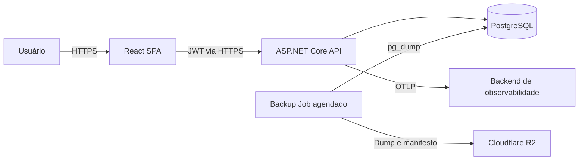

# Arquitetura

Este documento descreve a estrutura técnica atual. Consulte a [visão do produto](../product/overview.md) para escopo, o [modelo de domínio](../product/domain-model.md) para regras e os [ADRs](../adrs/README.md) para a motivação das principais escolhas.

## Contexto

Devlivery é um monorepo com dois processos de produto e um processo operacional:

## API

A composição ocorre em `Startup.cs`. As features ficam em `src/Devlivery/Features` e agrupam endpoint, comando ou consulta, validação e handler. O domínio em `Domain` permanece independente de HTTP e JWT. `Infrastructure` implementa persistência, autenticação, tenancy, observabilidade e representação HTTP.

O projeto usa Minimal APIs. Cada endpoint implementa `IEndpoint` (`Common/Endpoints`), declara sua rota completa relativa a `/api/v1` e sua tag (`Tags`), e é descoberto automaticamente por `AddEndpoints()`/`MapEndpoints()`; não há lista manual de endpoints por feature. Cada endpoint recebe por injeção a interface do seu handler (`ICommandHandler<TCommand, TResponse>` ou `IQueryHandler<TQuery, TResponse>`, em `Common/Handlers`); handlers de commands, queries e eventos de domínio são registrados por varredura do assembly com Scrutor. Todo command handler é decorado por `ValidationCommandHandlerDecorator`, que executa os validators FluentValidation do command e devolve `ValidationError` (HTTP 422) sem chamar o handler quando a entrada é inválida. As mensagens padrão em pt-BR ficam em `PortugueseLanguageManager`; validators declaram apenas regras e o nome do campo em português (`.WithName(...)`), e a chave em `errors` continua sendo o nome da propriedade. EF Core atende escrita e consultas que precisam do tracking; Dapper está disponível para consultas diretas. Há dois contextos no mesmo PostgreSQL:

- `ApplicationDbContext`: dados de negócio e migrações da aplicação;
- `ApplicationIdentityDbContext`: tabelas do ASP.NET Core Identity no schema `identity`.

Ambos devem receber suas migrações em cada publicação.

## Autenticação e tenancy

O token JWT carrega `sub` e `establishment_id`. O middleware autentica a assinatura antes de registrar o tenant da requisição. Entidades que pertencem a um estabelecimento implementam `ITenantScoped` (`Domain/SeedWork`), e o `ApplicationDbContext` aplica a todas elas, por convenção, um filtro global do EF Core para o estabelecimento corrente. Ler `ITenantAccessor.Tenant` sem tenant registrado lança exceção, em vez de consultar com um identificador vazio. Consultas que precisam atravessar tenants, como o login e o seed de desenvolvimento, usam `IgnoreQueryFilters()` explicitamente. SQL executado com Dapper não recebe esses filtros e deve filtrar `establishment_id`; os testes HTTP multi-tenant do dashboard e da listagem de despesas protegem essa regra.

Handlers que registram autoria resolvem o usuário do token no banco, dentro do tenant, e não confiam em identificadores enviados pelo frontend. O domínio recebe somente o identificador já resolvido.

## Eventos e consistência

Eventos de domínio são despachados pelo `UnitOfWork` antes da gravação, e as alterações dos handlers são persistidas no mesmo `SaveChanges` da operação que gerou os eventos. Os handlers de caixa decorrentes de pedidos executam dentro da requisição e recebem o contexto autenticado corrente. Se o processamento migrar para filas ou jobs, o autor e o tenant deverão ser transportados explicitamente no contrato do evento.

Pedidos, pagamentos, sessões de caixa e movimentações usam concorrência otimista pela coluna de sistema `xmin` do PostgreSQL (`IsRowVersion()` em uma propriedade sombra `uint`). Quando outra operação altera a mesma linha entre a leitura e a gravação, o EF lança `DbUpdateConcurrencyException` e a API responde 409 com Problem Details. A verificação vale por linha: incluir apenas uma entidade filha, como uma nova movimentação, não altera o `xmin` do agregado pai.

O banco é a fronteira de persistência compartilhada desta aplicação. Não há broker, cache distribuído ou limitador distribuído neste momento.

## Contratos HTTP

Respostas bem-sucedidas usam o envelope `data` e, quando aplicável, `meta`. Erros usam Problem Details com `title`, `status`, `detail` e erros de validação opcionais. O documento OpenAPI e o Scalar são expostos somente em desenvolvimento.

Os endpoints `/health` e `/alive` são públicos para a plataforma de hospedagem. `/health` verifica os dois contextos; `/alive` verifica somente o processo.

## Frontend

O frontend é uma SPA dividida por feature. TanStack Query controla o estado remoto, React Hook Form e Zod tratam formulários, e um serviço compartilhado centraliza a configuração HTTP, o token e a tradução de erros.

## Decisões e limites

- [ADR-001: monorepo e vertical slices](../adrs/0001-monorepo-and-vertical-slices.md)
- [ADR-002: tenant derivado do contexto autenticado](../adrs/0002-tenant-from-authenticated-context.md)
- [ADR-003: eventos de domínio síncronos](../adrs/0003-synchronous-domain-events.md)
- [ADR-004: contextos separados para negócio e identidade](../adrs/0004-separate-application-and-identity-contexts.md)

A API é um único processo de produto e compartilha um PostgreSQL entre as features. Não há broker, cache ou rate limiter distribuído. O job de backup é um processo separado e não participa das requisições do produto.

## Versionamento HTTP

`IEndpoint.Version` define a versão do grupo de cada endpoint, com v1 como padrão. Para novos contratos v2, declare `public ApiVersion Version => new(2, 0);` na implementação do endpoint dentro da feature. O registro agrupa endpoints por versão e o Scalar descobre os documentos automaticamente. A v2 só será publicada quando tiver endpoints reais; não há endpoint de demonstração na aplicação. O lançamento da v2 do app não altera automaticamente a versão dos contratos HTTP.

Os endpoints de negócio, incluindo login, são publicados em `/api/v1/...`. Asp.Versioning lê a versão exclusivamente pela URL; não existe fallback para rotas sem versão. `/health` e `/alive` continuam fora desse grupo. OpenAPI e Scalar permanecem disponíveis somente em desenvolvimento, com um documento por versão (`/openapi/v1.json`).

Mudanças incompatíveis de contratos exigem uma nova versão principal. Adições compatíveis podem permanecer na v1. Quando houver uma v2, mantenha endpoints e contratos específicos junto da feature correspondente e compartilhe handlers e regras de negócio apenas quando o comportamento continuar compatível. Não duplique toda a aplicação por versão.
