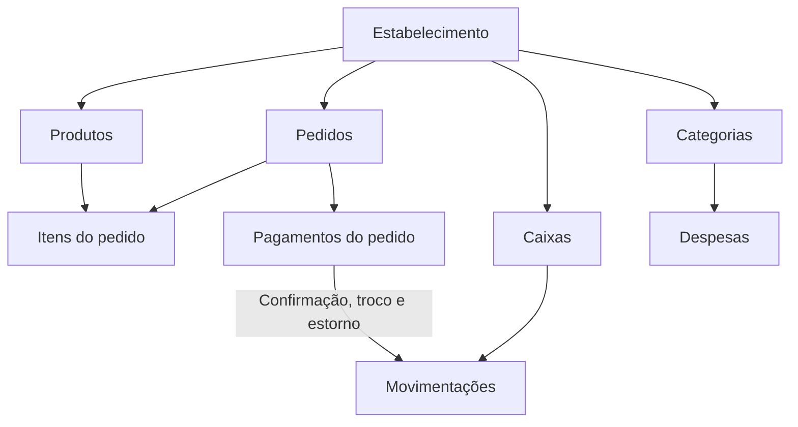
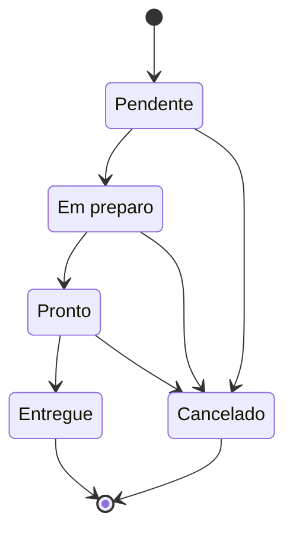

# Modelo de domínio

Este documento descreve o comportamento implementado no domínio e nos handlers da API. Nomes entre parênteses correspondem aos termos usados no código.

## Contexto e isolamento

Um **estabelecimento** (`Establishment`) é a fronteira do tenant. Produtos, pedidos, pagamentos, caixas, movimentações, despesas, categorias e usuários pertencem a um estabelecimento. O tenant vem da claim `establishment_id` do token autenticado e os filtros globais do EF Core restringem os dados da requisição.

A identidade do operador vem da claim `sub` e é resolvida no banco dentro do tenant. Comandos financeiros não devem aceitar o autor informado pelo cliente como fonte de verdade.

## Visão dos conceitos



O dashboard é uma capacidade de leitura sobre pedidos e despesas; ele não constitui um agregado de domínio.

## Produtos

O **produto** representa um item vendável do catálogo e possui nome, descrição, preço, categoria e disponibilidade. A indisponibilidade retira o produto da operação sem apagar seu histórico: ele não pode ser adicionado a pedidos, mas pedidos em aberto que já o contêm continuam editáveis. Ao entrar em um pedido, o item mantém quantidade e preço unitário próprios. Editar o pedido preserva o preço registrado dos produtos já presentes; produtos novos recebem o preço vigente validado pelo servidor.

## Pedidos e pagamentos

Um **pedido** exige pelo menos um item e uma forma de pagamento. Seu total é a soma dos itens com a taxa de entrega, que não pode ser negativa. Cliente, endereço, itens, observações e taxa podem ser atualizados enquanto o fluxo permitir a operação.

Os estados disponíveis são:



Essa sequência representa o fluxo operacional. No comportamento atual, a API aceita a mudança direta entre estados não terminais: não há uma máquina de estados que obrigue a passagem por cada etapa. Um pedido cancelado não muda novamente; um pedido entregue também não retorna a outro estado.

A operação de pedidos independe de caixa aberto: o atendente pode criar, editar, preparar, cancelar e entregar pedidos com o caixa fechado. Criar um pedido mantém os pagamentos pendentes. Entregar confirma os pagamentos e preserva valores, datas e troco no próprio pedido, sem abrir uma sessão automaticamente.

Para entregar um pedido:

- a soma dos pagamentos não cancelados deve cobrir o total;
- pagamentos pendentes são confirmados;
- o troco é a diferença positiva entre pagamentos e total;
- se houver caixa aberto, os eventos também registram pagamento e troco nessa sessão durante a mesma requisição; sem sessão aberta, a entrega continua normalmente.

Pagamentos podem usar dinheiro, cartão de crédito, cartão de débito ou Pix. Um pagamento confirmado não pode ser alterado ou removido pela reconciliação do pedido; primeiro deve existir o tratamento de estorno. Pedidos entregues ou cancelados não aceitam novos pagamentos.

A soma dos pagamentos eletrônicos não pode ultrapassar o total do pedido, inclusive ao criar ou editar. Apenas o dinheiro recebido pode produzir troco sobre o restante devido. Repetir a entrega de um pedido já entregue não altera datas nem gera eventos novos. A exclusão de pedidos entregues é bloqueada para preservar o histórico financeiro; um fluxo explícito de estorno permanece uma evolução futura.

Na interface, o mesmo produto com observações de preparo diferentes ocupa linhas distintas. A comanda informa todas as parcelas de pagamento, o troco previsto e os últimos oito caracteres do GUID do pedido em maiúsculas. Essa referência abreviada é apenas visual; o GUID completo continua identificando o pedido na API e no banco. Um identificador sequencial próprio fica para uma evolução futura.

## Caixa

A **sessão de caixa** representa um expediente financeiro. Só pode existir uma sessão aberta por estabelecimento. Ela registra o operador autenticado responsável pela abertura, o valor inicial e as movimentações.

As movimentações implementadas são:

- **pagamento:** criado quando um pagamento do pedido é confirmado;
- **troco:** criado uma vez por pedido, quando existe pagamento em dinheiro e diferença positiva;
- **estorno:** compensa pagamentos associados a pedido cancelado ou excluído;
- **aporte:** entrada manual no caixa, vinculada ao operador autenticado.

Pagamentos, trocos e estornos são idempotentes pelas referências de pedido ou pagamento. O caixa é opcional: recebimentos de entregas realizadas sem sessão aberta permanecem nos pedidos e no resumo de pagamentos confirmados do Dashboard, sem movimentar uma sessão fechada. Abrir um caixa depois não incorpora automaticamente essas vendas. Portanto, os totais de uma sessão representam somente suas movimentações, não todas as vendas do estabelecimento. A contagem do caixa usa pedidos distintos com pelo menos um pagamento não estornado, tanto na sessão ativa quanto no detalhe e na listagem. A contagem por forma de pagamento usa a mesma regra dentro de cada método; um pedido misto pode aparecer em dois métodos e continua sendo um único pedido no total.

O valor esperado em dinheiro é:

```text
valor de abertura + aportes + pagamentos em dinheiro - estornos em dinheiro - trocos
```

O fechamento registra o valor contado e encerra a sessão. Uma sessão fechada não recebe pagamentos, trocos, estornos ou aportes. Consulte [segurança do login e do caixa](../operations/login-and-cash-security.md) para autoria e proteção de acesso.

## Despesas

Uma **despesa** pertence a uma categoria, tem valor positivo, vencimento e, opcionalmente, fornecedor, descrição e data de pagamento. Informar a data de pagamento na criação torna a despesa paga; sem essa data, ela nasce pendente.

Estados e transições relevantes:

- pendente pode ser marcada como paga;
- o domínio permite cancelar uma despesa pendente, mas a API ainda não expõe esse fluxo: a exclusão remove a despesa;
- paga mantém uma data de pagamento e não pode ser cancelada; ainda não existe estorno que a devolva a pendente;
- cancelada não pode ser paga nem editada;
- a data de pagamento só pode ser corrigida enquanto a despesa está paga;
- atraso e vencimento no dia são classificações calculadas para despesas pendentes.

Na listagem, o filtro **Pendente** traz apenas despesas pendentes que ainda não venceram; **Vencida** e **Vence hoje** são filtros próprios. O filtro por categoria traz as despesas lançadas na própria categoria e em suas subcategorias.

Categorias podem conter subcategorias. Uma subcategoria não pode ser associada simultaneamente a mais de uma categoria.

## Consistência entre áreas

No dashboard, despesas pagas são selecionadas pela data do pagamento; despesas pendentes, pelo vencimento. Resumo, categorias e status seguem essa seleção e excluem despesas canceladas. A série de despesas pagas usa a mesma data do cartão de despesas pagas. A tela de contas a pagar continua filtrando pelo vencimento.

Os contratos atuais de vendas continuam considerando pedidos não cancelados pela data de criação. Por isso, a interface usa os rótulos **Valor dos Pedidos** e **Saldo Projetado**, com explicação de que há valores ainda não recebidos. O saldo projetado subtrai as despesas pagas e não representa o dinheiro disponível na gaveta. Separar receita realizada/prevista e adotar uma nova referência temporal de recebimento são evoluções da V2.

Eventos de domínio conectam pedidos e caixa sem tornar o agregado de pedido responsável pelo ledger financeiro. O processamento é síncrono e depende do tenant e do operador da requisição corrente. Veja [ADR-003](../adrs/0003-synchronous-domain-events.md) para as consequências dessa escolha.

Ao alterar uma regra descrita aqui, atualize o documento no mesmo pull request e acrescente testes no nível indicado pela [estratégia de testes](../development/testing-strategy.md).
